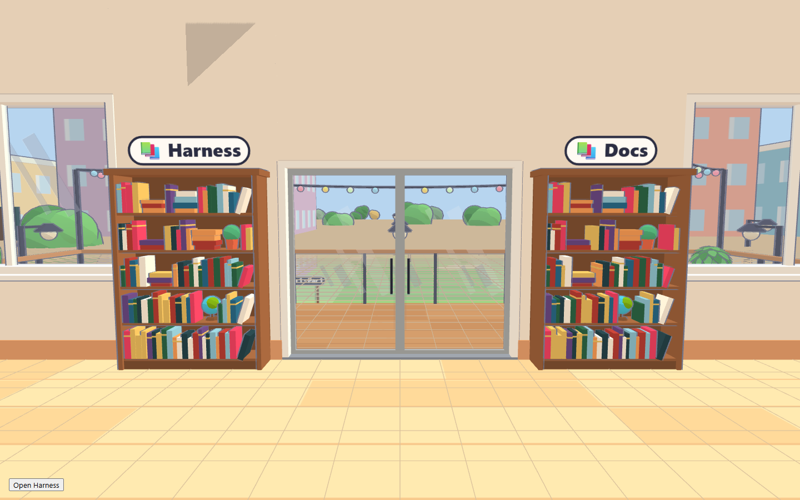
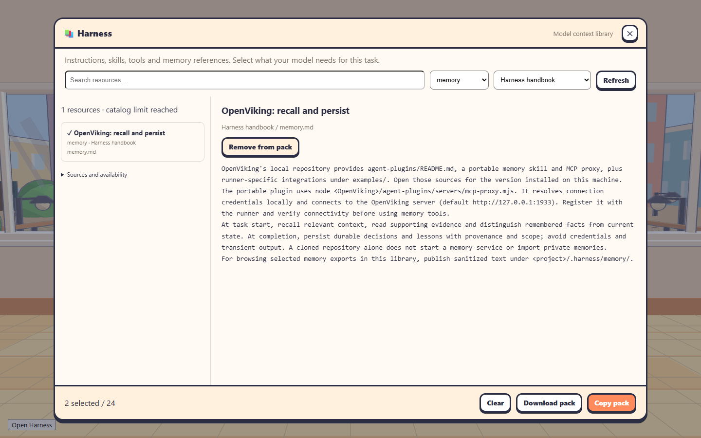
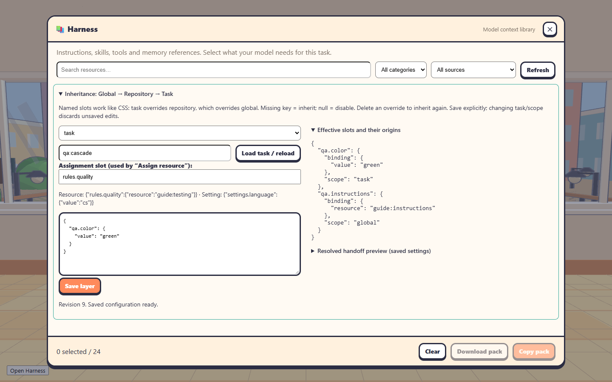

# Harness library

Back to the [README](../README.md).



The **Harness** bookshelf stands on the other side of the balcony doors from **Docs**, with the same wooden case and books. Walk up and press **E**. The window supports search, category and source filters, source availability, reading, and a selection of up to 24 resources. **Copy pack** or **Download pack** produces a model-neutral Markdown context pack with source paths. Close with the top-right ✕ or Esc to return to mouse-look.

The handbook covers instructions, skills, hooks, rules, commands, scripts, tools, MCP, memory, evaluations and operating procedures. Local resources appear alongside it. Resources are displayed as plain text; selecting one does not execute code, install a plugin, change a model's permissions or configure its runner. Use the native runner's configuration for hooks and MCP.



## Publish resources

Each floor reads its own project:

- Root instruction files: AGENTS.md, CLAUDE.md and GEMINI.md.
- .agents/skills, .claude/skills, .claude/commands, .claude/rules, .cursor/rules and .github/instructions.
- **.harness/**: publish additional instructions, hooks, commands, scripts, tools, MCP examples, sanitized memory exports, tests and runbooks here. Use matching subfolder names for categories.

Example layout:

```text
.harness/
  instructions/task-start.md
  hooks/after-tool.py
  rules/review.md
  commands/release.md
  scripts/check.ps1
  tools/browser.md
  mcp/example.json
  memory/decisions.md
  testing/evaluations.md
  operations/handoff.md
```

Publish only resources intended to be shared with people on that office. Files in these folders are available to signed-in users. The library skips credential-like filenames, environment files, binary files, symlinks, build/dependency folders and files over 128 KiB; these filters are not a secret scanner. Do not put credentials in published files. Discovery is bounded to 1,200 entries, 6,000 visited paths and 10 directory levels. The UI indicates a truncated catalog.

Admins and shared-password sessions also see the machine user's .agents/skills, .codex/skills, .claude/skills and .claude/commands. Named non-admin accounts only see project resources and the handbook. To publish another machine resource folder, set **AGENT_OFFICE_HARNESS_DIR** before starting the office. Refresh re-reads resources from disk.

## OpenViking

Set **AGENT_OFFICE_OPENVIKING_DIR** to the downloaded OpenViking repository. The library indexes its agent-plugins, docs/en and examples folders, including the portable memory skill, MCP proxy and runner-specific integration instructions. If unset, discovery checks up to seven project ancestors for OpenViking or 03.Agents-tools/OpenViking; it does not search the whole disk.

In PowerShell, before starting the office:

```powershell
$env:AGENT_OFFICE_OPENVIKING_DIR = 'P:\path\to\OpenViking'
agent-office
```

The source status says whether those files exist, **not** whether a memory server is connected. Read the installed version's agent-plugins/README.md and the integration guide matching your runner. The portable package starts its MCP proxy with Node and expects an OpenViking server, normally at http://127.0.0.1:1933. Its credentials stay in the native environment/configuration, outside exported context packs.

Configure the plugin in the chosen runner, verify a harmless memory read, then use its recall/persist workflow. Downloading the repository or opening this shelf does not start a server or expose private memories. To include selected memory in a portable context pack, publish a sanitized export under .harness/memory/.

## Any model with a shell or file input

After building the office, a local agent can use the same catalog without a browser:

```sh
node /path/to/agent-office/bin/office-harness.js --project /path/to/project
node /path/to/agent-office/bin/office-harness.js --project /path/to/project --read guide:instructions
node /path/to/agent-office/bin/office-harness.js --project /path/to/project --bundle guide:instructions guide:memory
```

Outside an office worker, the first command emits JSON with stable resource IDs; use those IDs with --read or --bundle. Local CLI access uses the current OS user's files and permissions and does not execute resources. Inside a worker (when `AGENT_OFFICE_HOOK_URL` is set), the command uses the authenticated office API instead, with the commands below; it never falls back to unrestricted local discovery. Remote models can receive the downloaded Markdown file or pasted context pack. Hooks, tool calls and MCP require support from the agent runner, independently of which model it runs.

A pack is a snapshot assembled from selected files at export time. Re-export after editing sources. It is reference material: repository instructions and the task's permissions still apply.

## Run and try the cascade

Build with `npm run build`, then run `node bin/agent-office.js . --port 4617 --password harness-preview --no-open` from a separate test checkout. Open http://localhost:4617, sign in, enter the office, and press **F8**. Alternatively, use **E** at the Harness shelf left of the balcony doors. **✕** and **Esc** both return immediately to mouse-look. The example password is for a loopback-only disposable preview, not a network deployment.

Open **Inheritance: Global → Repository → Task**. Each layer is a JSON object of named slots:

```json
{
  "rules.quality": { "resource": "guide:testing" },
  "settings.language": { "value": "cs" },
  "tools.browser": null
}
```

- **Global** applies to all repository floors in this office instance. Separate running offices do not share this store.
- **Repository** overrides matching global slots for this floor's checkout; other slots inherit.
- **Task** overrides matching slots for the selected task in that repository. Task IDs from Opora include project, workspace and card, so the same short ID elsewhere cannot collide.
- A missing key inherits. `null` explicitly disables an inherited assignment. Delete the override to inherit again. A binding replaces the whole binding at that key; there is no deep merge or instruction concatenation for the same slot.

Try `{"settings.color":{"value":"red"}}` globally, `blue` for the repository, and `green` for a task. Save each layer and inspect **Effective slots and their origins**. Removing the task override should reveal `blue`, then removing the repository override reveals `red`. Load a task before saving it. Switching scope or reloading discards unsaved edits. A revision conflict requires reloading; stale editors cannot overwrite another user's changes.

For resources, choose a semantic slot and scope in the inheritance editor, collapse it, select a book, click **Assign resource**, and **Save layer**. The first opening loads profiles automatically; the default slot is `rules.quality` at repository scope. Assignment edits and ad-hoc **Add to pack** selections are intentionally separate. Saving a layer persists assignments; exporting a pack does not.

**Resolved handoff preview** shows the exact saved configuration/content to be supplied to a worker, with scope provenance and SHA-256 snapshot digest. Missing or inaccessible resources show a blocking warning. Profiles survive restarts in `<office dataDir>/harness-profiles.json`. Repository identity is the absolute checkout path (case-insensitive on Windows); moving a checkout requires reassigning its repository/task profiles. Resource IDs are local installation IDs, not portable package names.

## Orchestrator handoff

The Opora planner/router receives these instructions automatically and has `office-harness` on PATH:

```sh
office-harness --catalog
office-harness --effective
office-harness --effective --task 'opora:PROJECT:WORKSPACE:CARD'
office-harness --assign repository assignments.json
office-harness --assign task assignments.json --task 'opora:PROJECT:WORKSPACE:CARD'
```

Use the actual namespaced task IDs returned by `--effective` (components are URL-encoded). `assignments.json` contains `{"revision":N,"layer":{...}}`, with the latest revision and the **complete replacement layer**. Include unchanged slots you want to retain. Configure task requirements before making a card runnable; automatic handout may dispatch ready cards as soon as the orchestrator finishes a turn.

Browser writes require an administrator/shared-password session and same-origin requests. The worker endpoint uses the worker's hook token and derives its repository from that worker, not caller input. Only the active Opora planner/router belonging to an administrator (or shared-password session) may change repository/task layers. Global writes are administrator UI-only. Ordinary workers can inspect their project-scoped effective context but cannot edit profiles or discover administrator machine resources.

Every `OporaBridge.take` path (manual take, autopilot, orchestrator handout) resolves profiles before claiming the card. It reads the selected resources, embeds the manifest and contents in the worker's initial prompt, and fails before claiming if something is unavailable or exceeds the budget. Later profile edits do not change an already seated worker's prompt. Limits: 64 slots per layer, 24 distinct effective resources, 96 KiB resolved handoff, 2 MiB persisted profiles. Invalid saved JSON fails closed and is not overwritten.

This first integration applies to **Opora card dispatch**, not arbitrary direct hires or the unrelated file-planning queue. Scalar settings are **context requirements**, not runtime provider flags: `settings.model` does not change the actual model selection. Resources do not install hooks, execute scripts, connect MCP, start OpenViking, grant tool permissions or override native runner/user instructions. Confirm those capabilities in the selected runner before relying on them.

## Verification

Run `npm run typecheck`, `npm test`, and `npm run build`. Focused coverage: `node --import tsx --import=#tests/css --test tests/harness*.test.ts tests/opora.test.ts tests/size.test.ts`.

With the isolated office running on 4617, `node tests/harness-office.browser.mjs` tests the **production bundle**, real session/catalog and F8/✕/Esc mouse-look behavior. For the editable visual lab, run Vite on 5187 and `node tests/harness-live.browser.mjs`: this forwards requests to the real authenticated office API, exercises all three layers and restores test settings unless a concurrent edit intervenes. It does not launch paid agents. `HARNESS_OFFICE_URL`, `HARNESS_PASSWORD`, `HARNESS_FLOOR`, `HARNESS_LAB_URL` and `HARNESS_SHOTS` customize these tests. Screenshots default to the OS temporary directory.


