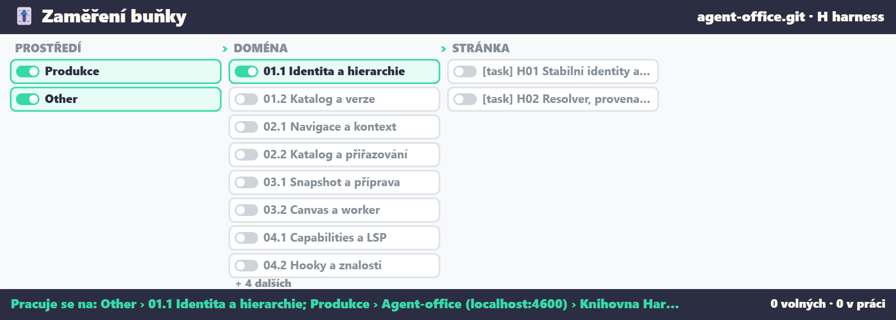
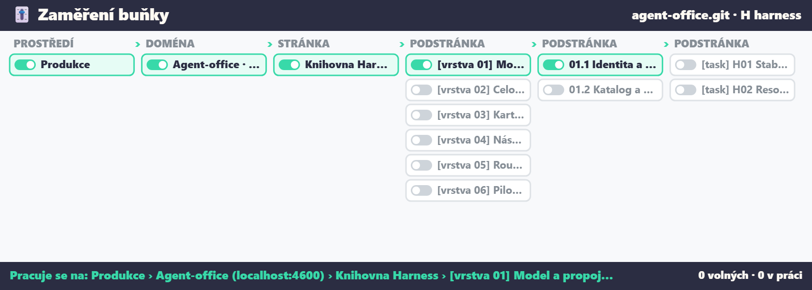

# Opora identity contract (version 1)

How the office names what it works on in Opora's canvas, so the 🎚️ switchboard, the Harness
library ([harness.md](harness.md)) and the cards the cell takes all mean the same node. Opora owns
every id; the office only reads them. The same contract is written down on Opora's side, in
`docs/kontrakt-identity.md` of `Pletor/opora-control-center-canvas`.

## The key

A node is `opora:<projectId>:<workspace>:<nodeId>`, each part URI-encoded
(`src/shared/opora-identity.ts`, `oporaKey`). It is also the Harness task id (`oporaHarnessTask`).
The same node id in another workspace of the project is a copy of the card, so another node: a key
from another project or workspace is refused with an error (`refuseForeign`), never remapped.

## The levels

`global` › `project` (the repository Opora plans) › `page` › `layer` › `area` › `sector` › `task`.
Every level below `global` is an Opora id, never a name or a position on the canvas.

- **Parent.** A card's or sector's place is its `parentId` on Opora. Opora already refuses a cycle
  or a missing parent when the canvas is written. A sector may sit under a card (the Harness plan
  nests `01.1 Identita a hierarchie` under `[vrstva 01]` under the page `Knihovna Harness`), and it
  keeps that parent: only a sector without a parent is a root domain of the switchboard.
- **Area.** An area is never a parent. A card or sector belongs to one only when its `memberOf`
  names the area, and the area has the same parent (`areaOf`). Opora validates that when the
  canvas is written; the office never guesses membership from where a card is drawn (Opora's
  geometric `areaId` stays what it was: a hint for the canvas, not membership).

The switchboard on the Harness plan, before and after nested sectors kept their parent: before,
every sector was torn out to a root domain under *Other* and the page's focus missed its tasks;
after, the way down is Produkce › Agent-office › Knihovna Harness › [vrstva 01] › 01.1 › H01.

## When a node moves or vanishes

The switchboard's architecture is read from the canvas again on every poll:

- A node whose parent is gone, is an area or loops back is left out, never lifted to a root.
- A focus is kept only while it still means what it meant when it was switched on: every node of
  it is there, with every node above it switched on too (`focusIntact`). A node that vanished or
  moved under another page breaks the focus, and the cell takes nothing until someone switches it
  again; it doesn't fall back to the whole project or to what's left of the focus.
- The focus remembers the project and workspace it was switched on in (`focusPlace` in
  `.agent-office/opora.json`). Read in another workspace, it takes nothing there until it's switched
  again; linking another project starts on the whole of that one.

## Versions

`OPORA_IDENTITY_VERSION` is 1. A change that reads ids differently bumps it on both sides, so the
Harness resolver and registry that build on it can tell which one they got.
